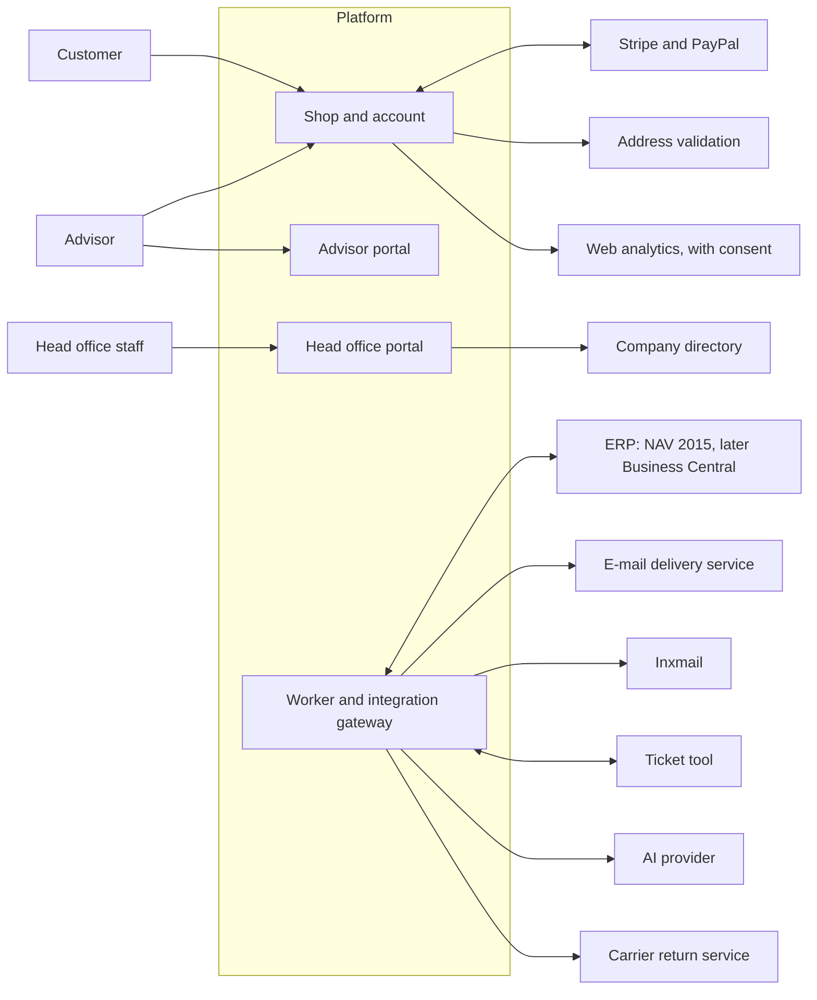
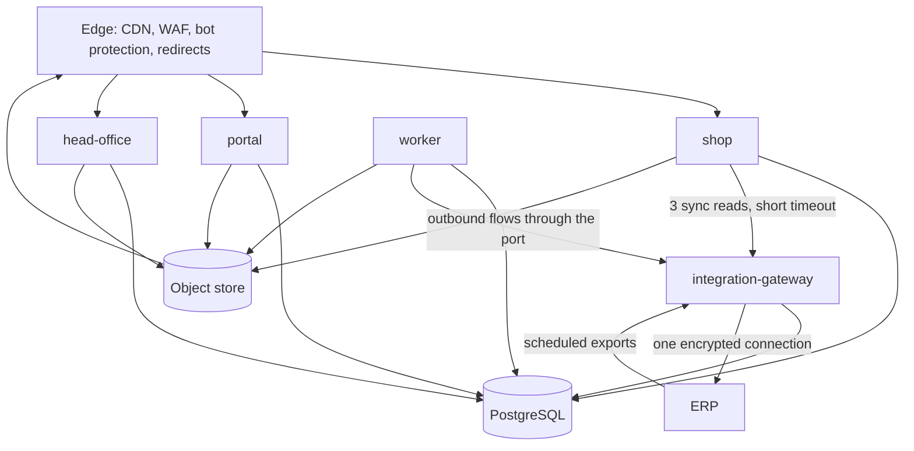
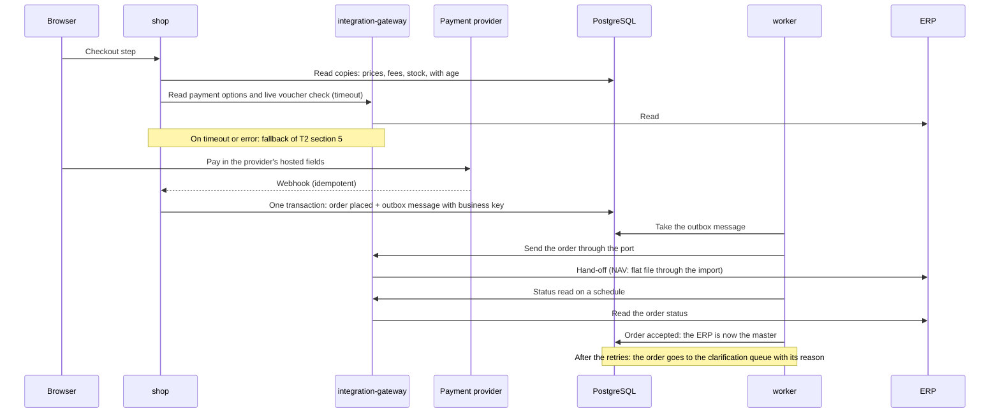

# Architecture

|              |                                                                                                      |
| ------------ | ---------------------------------------------------------------------------------------------------- |
| Status       | Proposed. It becomes the baseline when the ADRs it cites are accepted                                |
| Date         | 2 November 2026                                                                                      |
| Requirements | Discovery package v0.1, mainly T2, T3 and T4. Digest: [discovery-baseline.md](discovery-baseline.md) |
| Decisions    | [adr/](adr/README.md)                                                                                |

This document describes the target architecture of the platform: the shop with the customer account, the advisor portal, the head office portal and the background work. It explains how the design meets the package. The ADRs hold the reasons and the alternatives.

## 1. Drivers

| Driver                                                  | Source                               | Consequence for the design                                                                     |
| ------------------------------------------------------- | ------------------------------------ | ---------------------------------------------------------------------------------------------- |
| The ERP leads most data; the platform holds copies      | DP1, T1 section 2                    | A small commerce core of our own; read copies with source and age; no commerce engine          |
| One port to the ERP, two adapters over time             | T3-D-005, T2-D-001                   | ERP access only through the integration module; contract-first payloads                        |
| Provider-neutral hosting                                | T3-D-006, T3-O-001                   | Containers, PostgreSQL, an S3-compatible store, a queue on PostgreSQL; no single-cloud service |
| Short time to RC                                        | DR section 2                         | A modular monolith in one repository; one database; few moving parts                           |
| Settings without a release                              | DR section 8                         | Rule sets as versioned data                                                                    |
| Personal data rules and EU-only production access       | T3 section 5, T4 section 4, T4-O-002 | Field metadata, masked telemetry, deployments through Git                                      |
| Blue-green release, 99.5 % availability, RPO 15 minutes | T4 sections 2 and 5                  | Rolling blue-green on Kubernetes; managed PostgreSQL with point-in-time recovery               |

## 2. Context



The current shop runs next to the platform from RC to the cutover. No interface writes into the current shop (T1 section 3.1).

## 3. Runtime units

All units come from one repository and one build. See ADR-0003.

| Unit                  | Rendering       | Exposure                                                | Scaling                                   | Purpose                                                                                                        |
| --------------------- | --------------- | ------------------------------------------------------- | ----------------------------------------- | -------------------------------------------------------------------------------------------------------------- |
| `shop`                | Server-rendered | Public, main domain, behind the edge                    | Horizontal; carries the launch peak       | Catalogue, advisor path and page, cart, checkout, customer account, content pages, redirects, payment webhooks |
| `portal`              | Client-rendered | Public, own subdomain                                   | Horizontal                                | Advisor portal: customers, leads, tasks, figures, statements, own page, e-mail to a customer                   |
| `head-office`         | Client-rendered | Own subdomain, restricted at the edge                   | 1 to 2 replicas                           | Head office portal (A4-C-020)                                                                                  |
| `worker`              | —               | None                                                    | 1 or more; separate queues for heavy work | Scheduled and queued jobs (T3-D-003)                                                                           |
| `integration-gateway` | —               | Internal only, plus an allow-listed path for ERP pushes | 2 replicas                                | The only network path to the ERP: synchronous reads for the checkout, inbound ERP exports                      |



**Why a gateway.** T3-D-005 allows ERP access only through the integration module. T2-D-008 asks for one authenticated, encrypted connection. Three reads must be synchronous at the checkout (payment options, the live voucher read, the order history). The integration gateway gives one network identity, one set of ERP credentials and one egress path. The NAV adapter runs only in this unit. See ADR-0006.

**Note on T3.** T3 section 3 explains "one application image, one worker image". This design builds one image per web app and one image for the worker and the gateway. T3 allows this change if the acceptance criteria and the T4 values hold (T3 section 3). ADR-0003 records it.

## 4. Modules

The domain code lives in `packages/core`. It has no dependency on the web framework. Each module owns its PostgreSQL schema and exposes a public API through its `index.ts`. A module never reads another module's tables.

| Module         | Owns                                                                                                        | Reads from the ERP (through `integration`)                                     | Emits events                                     |
| -------------- | ----------------------------------------------------------------------------------------------------------- | ------------------------------------------------------------------------------ | ------------------------------------------------ |
| `identity`     | Person, roles with dates, credentials, sessions, staff accounts, consents, preferences, pets, consultations | Customer and advisor master data, assignment                                   | Person registered, consent changed, role started |
| `commerce`     | Catalogue view, cart, checkout, payments, voucher redemption, calculators, orders until the hand-off        | Prices, campaigns, vouchers, fees, stock, payment options                      | Order placed, payment captured, order accepted   |
| `subscription` | Subscriptions, schedules, due-delivery run, holds, self-service, charge at shipment                         | Shipment report, payment options                                               | Delivery due, delivery charged                   |
| `commission`   | Periods, points, levels, runs, statements, comparison, commission settings                                  | Point values, corrections, structure, assignment, invoice status, NAV's result | Run released                                     |
| `journey`      | Events, journeys, tasks, leads, messages, advisor e-mails                                                   | Order, invoice and payment events                                              | Task created, message sent                       |
| `content`      | Pages, product texts, media and variants, advisor pages, moderation                                         | —                                                                              | Content published                                |
| `ai`           | The AI gateway: prompt, limit, record and off switch per function (T3-D-010)                                | —                                                                              | —                                                |
| `integration`  | Outbox, copies (`erp_copy` schema), reconciliation, message log, the ERP port client                        | All ERP flows                                                                  | Copy refreshed, message failed                   |
| `kernel`       | Rule sets and settings, audit log, pilot switch, feature flags, money, time, IDs                            | —                                                                              | Setting changed                                  |

**Rules** (checked in CI, see section 9):

1. A module imports another module only through its `index.ts`.
2. Only `integration` depends on `packages/erp-port`. Only `apps/integration-gateway` and `apps/worker` load an adapter (`erp-nav`, `erp-fake`, later `erp-bc`).
3. `packages/core` does not import the web framework, the HTTP layer or an app.
4. Cross-module reactions run through events on the queue, not through direct writes.

## 5. Data

- **One PostgreSQL database**, one schema per module, plus `erp_copy` for the read copies (T3-D-004, T3-D-007). Drizzle defines the schema and generates the migrations (ADR-0005).
- **Migrations are backward compatible**: expand, deploy, then contract. Old and new app versions run at the same time during a blue-green release.
- **Every personal data column** carries metadata: purpose, owner, retention. A column without it fails CI (ADR-0011, T3 section 5).
- **Every copy row** records its source, its source version and its sync time (T2-D-009).
- **Money** is an integer in minor units with a currency. Rounding rules are explicit functions with property tests.
- **Time** is stored in UTC. Business rules use the `Europe/Berlin` calendar unless a rule says otherwise (Discovery #102).
- **IDs** are UUIDv7 inside the platform. The ERP keys (customer number, advisor number, article number) are separate, indexed columns. Platform order numbers use their own range (T2-O-002).
- **The brand field** exists on the entities that a second brand would split (T3-D-013).
- **The object store** holds media and its variants, and the migration extracts and reports in the production account. It is reached through a storage port with an S3 adapter, and an Azure Blob adapter if Azure is chosen (ADR-0008).

## 6. Key flows

### 6.1 Checkout and order hand-off



### 6.2 Read copies

The worker refreshes each copy on the schedule of T2 section 4.2, through the gateway. The ERP can also push an export to the gateway (N-11). Each run records its time and its count. A copy older than its maximum age triggers an alert and the stale behaviour of T2 section 5. A daily reconciliation compares each copy with its master (T2-D-007).

### 6.3 Subscription delivery

1. At the cutoff, the due-delivery run creates one order per due delivery (A2, T4-R-006).
2. The order goes to the ERP with the subscription marker (T2-C-002).
3. The ERP ships it and reports the shipment and the invoice amount (T2-C-021).
4. The platform charges the card or PayPal agreement (A2-D-009) and sends the payment result (T2-C-005).
5. A failed charge becomes an open item for the ERP's dunning (A2-C-023).

### 6.4 Commission run

1. The worker builds the month from the copies: points, corrections, structure with history, assignment, invoice status.
2. A draft run produces the statements. Head office reviews them in the head office portal.
3. In the parallel phase, the platform compares its result with NAV's result (T2-C-020).
4. After the switch, the released result goes to the ERP (T2-C-007).
5. A run uses one version of the rule set. The version is stored with the period.

### 6.5 Pilot mode

The pilot switch (T3-C-001) is a `kernel` setting per advisor, with an audit entry. A request on an advisor path, a login or a checkout checks the pilot gate. A customer of a non-pilot advisor goes to the current shop. At the cutover every advisor is switched on.

### 6.6 Media pipeline

An upload goes straight to the object store with a signed URL. A job creates the desktop and mobile variants: images with `sharp` in seconds, videos with `ffmpeg` on a separate queue so a video never blocks other jobs (T4-R-014). The edge serves the variants.

## 7. Cross-cutting concerns

| Concern                | Design                                                                                                                                                                                                                                         |
| ---------------------- | ---------------------------------------------------------------------------------------------------------------------------------------------------------------------------------------------------------------------------------------------- |
| Identity and sessions  | One person record with dated roles (T3-D-009). One session across `shop` and `portal`. Staff sessions are separate and live only on the `head-office` host. Staff sign in through OpenID Connect to the company directory (T3-O-002). ADR-0007 |
| Authorisation          | Policy functions in `core`, called by the server functions. Roles: customer, advisor, partner, staff roles from directory groups. Support access to a customer record is logged (T4-R-023)                                                     |
| Settings and rule sets | Versioned, schema-validated data with an effective date; loaded through the head office portal or a CLI job; audited. ADR-0010                                                                                                                 |
| Audit log              | Append-only table for head office actions, commission settings and releases; two-year retention (T4-R-028)                                                                                                                                     |
| Idempotency            | A business key on every outbound message (T2-D-006); idempotency keys on payment calls; webhook events stored by provider event ID                                                                                                             |
| Errors                 | An order that fails after the retries goes to the clarification queue. Any other failed message goes to the monitoring view for IT (T2 section 6)                                                                                              |
| Languages              | German and English from the start; message catalogues per app; product and page content per language in `content` (T3-D-014). ADR-0014                                                                                                         |
| Design system          | Tokens as runtime data (CSS custom properties from a token set); components in `packages/ui`; accessibility checks in CI (A6, T4-R-012). ADR-0014                                                                                              |
| Telemetry              | OpenTelemetry traces, metrics and logs; no personal data in any of them; one dashboard per T4 area. ADR-0012                                                                                                                                   |
| Feature switches       | Simple switches in `kernel` for functions whose input is late, so a function can wait without a code branch                                                                                                                                    |

## 8. Repository layout

```text
apps/
  shop/                  server-rendered shop and account
  portal/                advisor portal
  head-office/           head office portal
  worker/                jobs and schedules
  integration-gateway/   the ERP connection
packages/
  core/                  domain modules, Drizzle schema, application services
  erp-port/              the port: operations, payload contracts (Zod), no I/O
  erp-nav/               NAV 2015 adapter
  erp-fake/              fake adapter with seeded data, for development and tests
  ui/                    design tokens and components
  server-kit/            shared server middleware: session, roles, pilot gate, errors, telemetry
  config/                shared TypeScript, Biome and test settings
tools/
  migrate/               migration loads and reconciliation reports (T1)
  seed/                  synthetic data, no personal data
  traceability/          acceptance criterion coverage report
infra/
  terraform/             cloud resources per provider
  helm/                  charts for the runtime units
  argocd/                environment definitions
docs/
  adr/  contracts/  privacy/  runbooks/  reviews/
```

## 9. Architecture checks

These checks run in CI on every pull request. A failed check blocks the merge.

| Check                                  | Tool                                 | Protects                                                 |
| -------------------------------------- | ------------------------------------ | -------------------------------------------------------- |
| Module boundaries and ERP access       | dependency-cruiser                   | Section 4 rules, T3-AC-001                               |
| No server code in a client bundle      | Bundle scan after the build          | Secrets and server logic stay on the server              |
| Personal data metadata on every column | Schema script                        | T3 section 5, T4-R-030                                   |
| Payload contract compatibility         | Contract snapshot diff               | A contract change is visible and reviewed (DR section 8) |
| Migration safety                       | Migration lint for destructive steps | Blue-green releases                                      |
| Acceptance criterion coverage          | `tools/traceability`                 | Report for R0, RC and R1                                 |
| Log masking                            | Log sample test                      | T4-R-034, T4-AC-006                                      |
| Accessibility                          | axe in the end-to-end tests          | T4-R-012                                                 |

## 10. How the design meets T3

| Item                | How                                                                                 |
| ------------------- | ----------------------------------------------------------------------------------- |
| T3-D-001 to -004    | Modular monolith, one repo, one database, a queue on PostgreSQL. Units per ADR-0003 |
| T3-D-005, T3-AC-001 | Port in `erp-port`; adapters only in the gateway and the worker; dependency check   |
| T3-D-006, T3-AC-005 | Kubernetes, PostgreSQL, S3 API, pg-boss; no single-cloud runtime service (ADR-0008) |
| T3-D-007            | `erp_copy` schema, written only by jobs                                             |
| T3-D-008            | Server rendering in `shop`; client rendering in `portal` and `head-office`          |
| T3-D-009, T3-AC-003 | One `person` table; at most one ERP customer number, unique; roles with dates       |
| T3-D-010, T3-AC-006 | `ai` module; a call record per call; an off switch per function                     |
| T3-AC-002           | `make up` on a clean environment; blue-green release keeps the shop available       |
| T3-AC-004           | Consent record: type, text version, date, source, withdrawal                        |
| T3-O-002            | Standard protocols for the login and the staff sign-in (ADR-0007)                   |

## 11. Open points

| Point                                                      | Owner                                | Decide by        |
| ---------------------------------------------------------- | ------------------------------------ | ---------------- |
| Cloud provider (ADR-0008)                                  | Provital                             | 27 November 2026 |
| Identity library or identity server (ADR-0007)             | Tech lead                            | 13 November 2026 |
| The path scheme for advisor paths and languages (ADR-0014) | Tech lead, design                    | 20 November 2026 |
| Transactional e-mail provider                              | 57Blocks proposal, Provital confirms | 11 December 2026 |
| AI provider                                                | Provital approves (A5-O-003)         | 18 December 2026 |

## Change log

| Version | Date            | Change                                                                           |
| ------- | --------------- | -------------------------------------------------------------------------------- |
| 0.2     | 2 November 2026 | AI provider approval due 18 December 2026, to match TD-38 and delivery plan v0.3 |
| 0.1     | 2 November 2026 | First version                                                                    |
