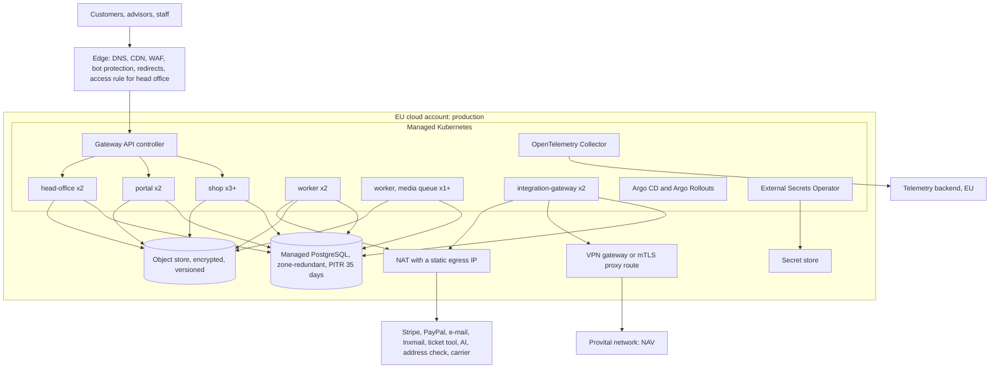

# Infrastructure

| | |
|---|---|
| Status | Proposed. The cloud provider is open (T3-O-001, Discovery #123) |
| Date | 2 November 2026 |
| Requirements | T3-D-006, T3-O-001, T4 sections 2 to 5. Digest: [discovery-baseline.md](discovery-baseline.md) |
| Decisions | ADR-0008 (runtime and cloud), ADR-0011 (personal data), ADR-0012 (telemetry) |

This document lists what the platform needs to run, where it runs, and in which order the team sets it up. It names no prices. The contract sets who holds and pays the cloud and service accounts.

## 1. Requirements that shape the infrastructure

| Requirement | Value | Source |
|---|---|---|
| Provider-neutral container platform in the EU | No managed runtime service that only one cloud offers | T3-D-006, T3-AC-005 |
| The account can move to Provital's | Infrastructure as code; no hand-made resources | T3-O-001 |
| Load | 300 concurrent visitors; peaks of 1,500 for an hour; launch-day login wave | T4-R-004, T1-O-002 |
| Response time | Pages 1.5 s, checkout steps 2.0 s (95th percentile) | T4-R-002, T4-R-003 |
| Availability | 99.5 % per month; blue-green release | T4-R-001, T4 section 5 |
| Backup and recovery | Point-in-time recovery for 35 days; RPO 15 minutes; RTO 4 hours; three restore tests | T4-R-008 to T4-R-010 |
| Security | TLS and HSTS, encryption at rest, managed secrets, least privilege, rate limits and bot protection | T4-R-020 to T4-R-025 |
| Residency | Hosting and processing in the EU; a service outside the EU needs Provital's written approval | T4-R-032 |
| Production data access | Staff outside the EU only on a confirmed legal basis | T4-O-002 |
| ERP connection | One authenticated, encrypted connection | T2-D-008 |

## 2. Target topology

## 3. Component inventory

| Component | Choice | Why | Where |
|---|---|---|---|
| Container platform | Managed Kubernetes: AKS or EKS | The neutral container runtime that T3-D-006 asks for | All shared environments |
| Ingress | Gateway API with a maintained controller, for example Envoy Gateway | Portable. The ingress-nginx project is retired; do not use it | All |
| Blue-green release | Argo Rollouts | T4 section 5 asks for blue-green; works on both clouds | Staging, production |
| Deployment | Argo CD, pulling from Git | No engineer needs production cluster credentials (T4-O-002); every change is a reviewed commit | All shared environments |
| Database | Managed PostgreSQL (Azure Database for PostgreSQL Flexible Server, or Amazon RDS for PostgreSQL), newest major version that both offer | Open standard; managed HA and point-in-time recovery meet T4-R-008 and T4-R-009 | All |
| Queue | pg-boss on the same PostgreSQL | One queue without a second system (T3-D-004) | All |
| Object store | S3 API, or Azure Blob through the storage port | Media and its variants; migration extracts and reports | All |
| Secrets | Cloud secret store, synced by External Secrets Operator | T4-R-022; the same manifests on both clouds | All |
| Edge | A CDN with WAF and bot protection, for example Cloudflare | Caching, bot protection for login and checkout (T4-R-025), redirects of old advisor domains (A3-C-001). Needs Provital's approval under T4-R-032 if requests are processed outside the EU | Staging, production |
| Container registry | GitHub Container Registry until the cloud is chosen; then the cloud registry | Images promoted by digest, never rebuilt | All |
| Telemetry | OpenTelemetry Collector; a Grafana-compatible backend in the EU; error tracking in an EU region or self-hosted | One dashboard per T4 area; no personal data (ADR-0012) | All |
| ERP connection | Site-to-site VPN, or an HTTPS route with mutual TLS and an IP allowlist. Provital's IT chooses with us | T2-D-008; only the integration gateway uses it | Staging, preprod, production |
| Static egress IP | NAT gateway | Allowlisting at NAV and at the external services | Staging, preprod, production |
| Local stack | Docker Compose: PostgreSQL, MinIO, Mailpit, Stripe CLI | One command for a working laptop | Local |

## 4. Environments

| Environment | Purpose | Account | Data | ERP | Payments and e-mail | Access | Ready by |
|---|---|---|---|---|---|---|---|
| Local | Development | Laptop | Synthetic | `erp-fake` | Mocks, Stripe test, Mailpit | Engineer | 6 Nov 2026 |
| Development | Every merge to `main` | Non-production; interim account until the cloud is chosen | Synthetic | `erp-fake`; NAV test on request | Test mode; Mailpit | Team | 13 Nov 2026 |
| Staging | Release builds; Provital's acceptance test of R0 and R0.x; contract tests | Non-production, target cloud | Synthetic and masked NAV test data | NAV test environment (T2-P-001) | Test mode; e-mail only to an allowlist | Team; Provital's testers | 4 Dec 2026 (interim account if needed); target cloud by 18 Dec 2026 |
| Preprod | The rehearsal on a production-like copy (A7-D-002) | Production account | Production-like personal data | A NAV copy for the rehearsal | Test mode; e-mail only to an allowlist | EU staff and Provital's operator only | 5 Feb 2027; removed after the cutover |
| Production | Pilot mode from RC; launch at R1 | Production account | Personal data | Production NAV | Live | Deployment through Git; data access per section 8 | 15 Jan 2027, so the pen test and the rehearsal can use the same set-up |

**Staging is the acceptance environment.** It receives tagged builds only. Development receives every merge. Provital tests a stable build while the team keeps working.

**Two accounts at least:** one for non-production, one for production. They share no network and no credentials.

## 5. Cloud provider options

Provital names the provider (T3-O-001). The code runs on both. This table shows where they differ for us.

| Topic | Azure | AWS |
|---|---|---|
| Region | Germany West Central; West Europe where a service is missing | eu-central-1 (Frankfurt) |
| Kubernetes | AKS | EKS |
| PostgreSQL | Flexible Server; zone-redundant HA; backups up to 35 days | RDS for PostgreSQL; Multi-AZ; backups up to 35 days |
| Object store | Blob Storage. **Not the S3 API**: needs the Azure adapter of the storage port | S3 |
| Secrets | Key Vault | Secrets Manager |
| Staff sign-in | Same tenant as Provital's company directory; simple app registration | Works through OpenID Connect; no difference for the app |
| AI provider in the EU | Azure OpenAI with EU data zone deployments; other EU providers through the gateway | Amazon Bedrock in Frankfurt; other EU providers through the gateway |
| Fit with Provital | Provital uses Microsoft accounts, the company directory and, from R2, Business Central. An account transfer to Provital is simple if Provital already has a tenant | Neutral |
| Business Central at R2 | Reached through its online APIs on either cloud. Not a deciding factor | Same |

**Recommendation.** If Provital's IT will own and run the account after the hypercare, choose Azure: it fits Provital's Microsoft estate and the planned account transfer. If 57Blocks holds the account for the long term, both work; choose by the team's experience. In both cases decide by 27 November 2026.

**Until then** the development environment runs in an interim 57Blocks account in the EU. The same infrastructure code later builds the target environments. Nothing in the interim account holds personal data.

## 6. Network and connectivity

- **Public entry** only through the edge. The cluster accepts traffic only from the edge (allowlist or authenticated origin).
- **The head office portal** has an extra access rule at the edge: Provital's office network or an identity check, in addition to the staff sign-in.
- **The integration gateway** is the only unit with a route to the ERP. A Kubernetes network policy enforces it.
- **Inbound ERP exports** (N-11) reach the gateway on one path, with mutual TLS or a token, and an IP allowlist of Provital's network.
- **Outbound calls** leave through the NAT gateway with a static IP.
- **The database and the object store** have private endpoints only. No public IP.
- **Before the cutover** Provital lowers the DNS TTL of the main domain and the old advisor domains, so the switch at 00:00 takes effect fast (A7 section 5).

## 7. Data protection, backup and recovery

| Topic | Design |
|---|---|
| Encryption | TLS 1.2 or newer with HSTS; database, backups and object store encrypted at rest (T4-R-020, T4-R-021) |
| Database backups | Managed continuous backup with point-in-time recovery for 35 days. Copies in a second EU region for a region outage |
| RPO 15 minutes | Met by continuous WAL archiving of the managed service |
| RTO 4 hours | Restore to a new server, switch the connection secret, roll the pods. The runbook is tested |
| Restore tests | Before RC, before the cutover, in the hypercare (T4-R-010). Each test records its duration |
| Object store | Versioning and soft delete on; lifecycle rules for migration files |
| Outbox payloads | Encrypted columns; bank details removed at the ERP confirmation; the rest deleted after 90 days (T4-R-036) |

## 8. Access model

| Group | Development | Staging | Preprod and production |
|---|---|---|---|
| All engineers | Full | Deploy through Git; read telemetry | Deploy through Git; read telemetry, which holds no personal data; no data access |
| Engineers with a confirmed legal basis for personal data (T4-O-002) | Full | Full | Break-glass access to data, time-limited and logged |
| Provital's operator | — | — | Runs the migration jobs and data tasks (T1-O-006) |
| Provital's testers | — | Application roles only | — |

Access is granted through the cloud's single sign-on groups. No shared accounts. The production Kubernetes API is private. Database access in production goes through a just-in-time, logged path.

## 9. CI/CD and supply chain

1. **Pull request:** install, type check, lint, unit tests, integration tests on PostgreSQL, build of the affected apps, architecture checks ([architecture.md](architecture.md) section 9), secret scan, dependency audit.
2. **Merge to `main`:** build one image per runtime unit, tagged with the commit SHA; scan the images; Argo CD deploys to development; end-to-end tests run there.
3. **Release tag:** the same images go to staging by digest. End-to-end and contract tests run.
4. **Production:** a named approver approves the promotion. The database migration runs as a job first. Argo Rollouts switches blue to green after the health checks.
5. **No release in the content freeze** (T4 section 5, A7 section 5.2). The pipeline enforces it with a date window.

The pipeline logic lives in scripts in the repo. The CI YAML only calls them. If the repo moves to another host (Discovery #122), only the YAML changes.

## 10. Third-party services

| Service | Interface | Release | Status | EU requirement |
|---|---|---|---|---|
| Stripe (card, iDEAL) | T2-C-030 | RC | Decided (A2-C-019); Provital's account (A2-P-002) | EU processing per the provider's agreement |
| PayPal | T2-C-030 | RC | Decided; Provital's business account (A2-P-001) | Same |
| Transactional e-mail | T2-C-036 | RC | **Open.** First check whether Provital's Inxmail contract covers transactional e-mail; that saves one processor. Otherwise an EU provider | EU |
| Inxmail (marketing) | T2-C-031 | R1 | Decided (decision log D58) | EU |
| Ticket tool (INEXSO) | T2-C-032 | RC | Decided (Discovery #191); API access needed | EU |
| AI provider | T2-C-033 | R1 | **Open.** Provital approves (A5-O-003) | EU or an approved location; no training on platform data |
| Address validation | T2-C-034 | RC | **Open** | EU |
| Carrier return service | T2-C-035 | R1 | Provital's carrier account; the process is open (Discovery #205) | — |
| Web analytics | T2-C-037 | R1 | **Open** (Discovery #207) | Consent required (T4-R-038) |
| Edge provider | — | RC | **Proposal** | Needs Provital's approval if processing is outside the EU |
| Telemetry and error tracking | — | RC | **Proposal**: EU region or self-hosted | EU; no personal data sent |
| Source code hosting | — | Now | GitHub, `57blocks` organisation | No personal data in the repo |

Each service needs a processing agreement (T4-R-031). Legal counsel reviews them (T4-P-002).

## 11. Initial sizing

Starting points only. The load test before the cutover sets the final values (T4-AC-001).

| Unit | Production start | Notes |
|---|---|---|
| `shop` | 3 replicas, autoscale to 10 | Anonymous catalogue pages cached at the edge |
| `portal` | 2 replicas | |
| `head-office` | 2 replicas | |
| `worker` | 2 replicas | Due-delivery run: 60 minutes at twice today's volume (T4-R-006) |
| `worker` on the media queue | 1 replica, more CPU, autoscale on queue depth | Video variants in 5 minutes (T4-R-014) |
| `integration-gateway` | 2 replicas | |
| PostgreSQL | 4 vCPU, 16 GB, zone-redundant | The data set is small: about 30,000 customers and 360,000 orders a year |
| Non-production | Single zone, smallest sizes | |

## 12. Items with a long lead time

| Item | Typical lead time | Start by |
|---|---|---|
| Network path to the NAV test environment, with Provital's IT | 2 to 4 weeks | 9 Nov 2026 |
| Cloud account set-up in the chosen provider | 1 to 2 weeks | Right after the decision |
| Sending domain: DNS records and sending reputation before about 30,000 set-password e-mails | 4 to 6 weeks before the mass sending | 8 Jan 2027 |
| Payment accounts: Stripe verification; PayPal API access and the billing agreement permission | 1 to 3 weeks | 9 Nov 2026 |
| Company directory app registration and staff groups | 1 to 2 weeks | 30 Nov 2026 |
| Penetration test booking | 4 to 8 weeks | 15 Jan 2027 at the latest |
| Data protection impact assessment, signed before the rehearsal (T4-R-030) | Several weeks of review | Draft of the technical description by 15 Jan 2027 |
| DNS TTL reduction before the cutover | Days | Week before the cutover |

## 13. Set-up order

1. Interim account and the development environment (week 1).
2. Infrastructure code modules for both clouds, where they differ (weeks 2 and 3).
3. Cloud decision; the non-production account in the target cloud; staging (by 18 December).
4. Network path to the NAV test environment; contract tests on staging.
5. Production account; production and preprod built from the same code (by 15 January).
6. Edge, DNS and the pilot address; monitoring and alerting in production (by 5 February).
7. Restore test, pen test and rehearsal before RC.

## Change log

| Version | Date | Change |
|---|---|---|
| 0.1 | 2 November 2026 | First version |
